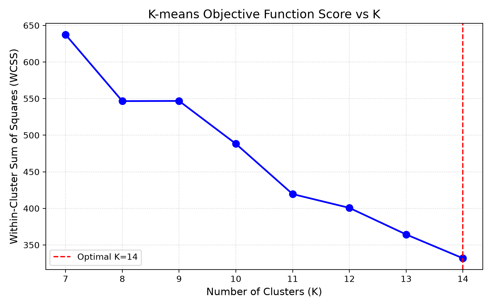
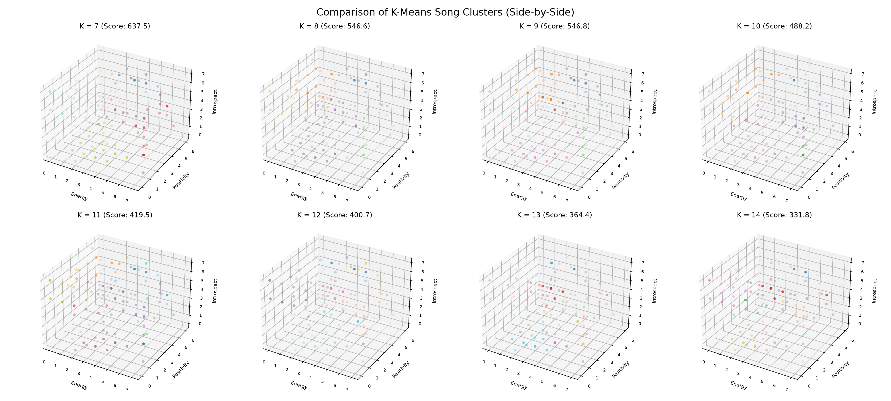
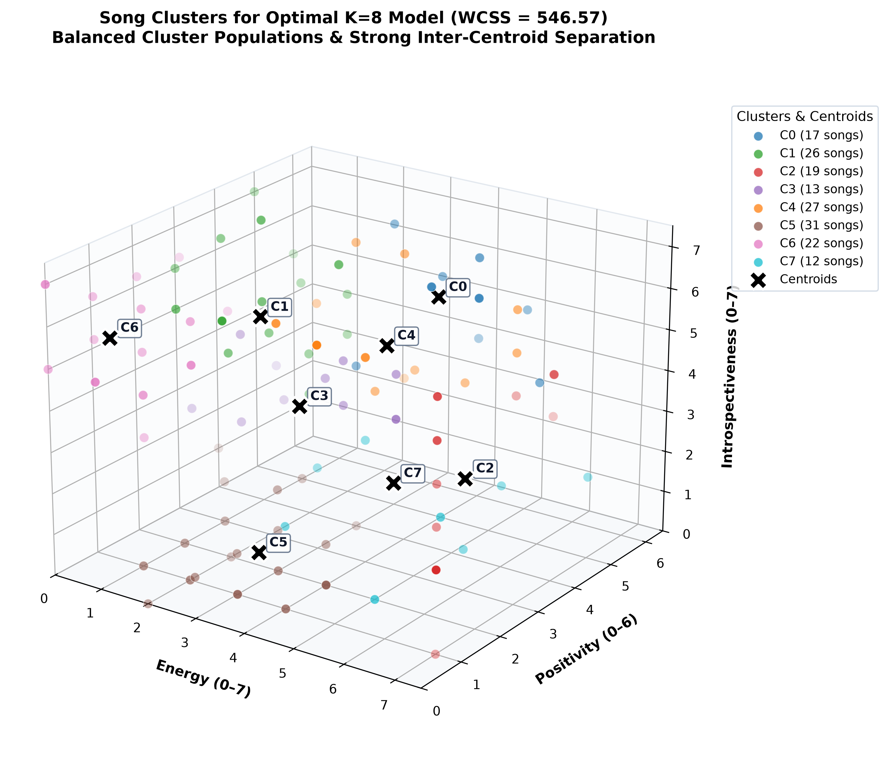
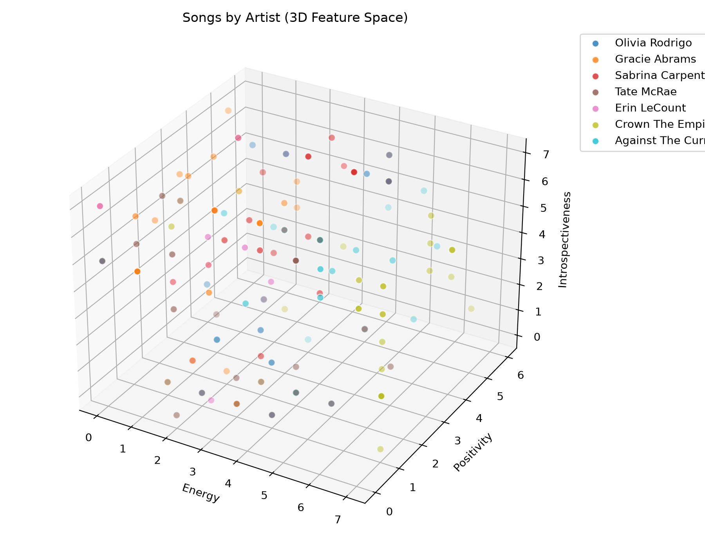
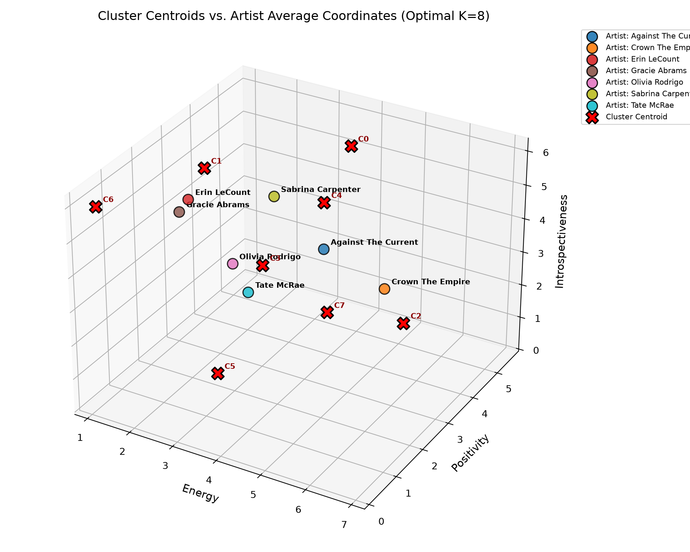
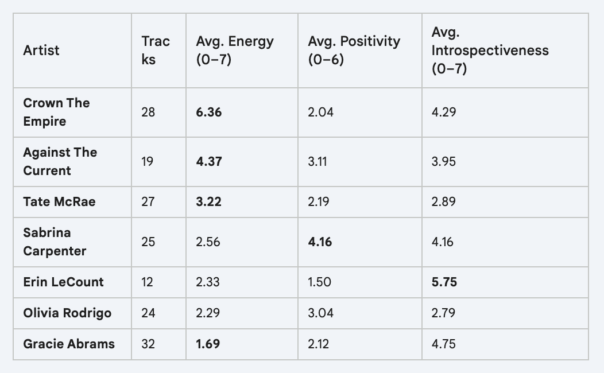
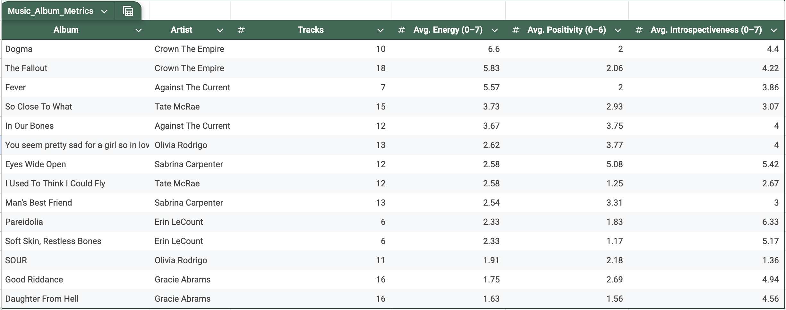
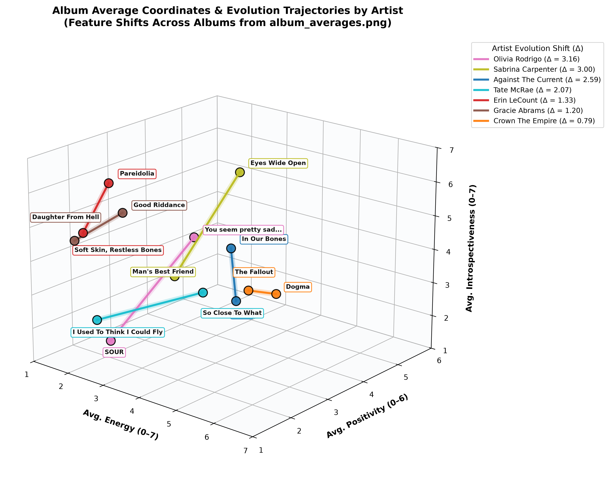

# Analyzing Artist Styles Using K-means Clustering

I test multiple K-means models with varying values of K to learn hidden clusters in song data from my favorite artists. To find the optimal value of K, I compare the final scores of the K-means objective function for each model:

```math
J = \sum_{i=1}^{k} \sum_{x \in C_i} \Vert{}x - \mu_i\Vert{}^2
```
\
Let mu denote the set of centroids, and C represent the function that assigns points x to centroids. 

(Summary of results here)

(Blog post forthcoming)

For future work, I will develop a model to run a "favorite song tournament" that takes in a song dataset provided by the user (8-128 songs) and the number of songs in each match (2-8). It will prompt the user to enter the results for 1 round of the tournament, and use a feed-forward neural network to analyze the importance of each feature in the dataset in deciding match outcomes. Using that learned model, it will automatically complete the rest of the matches and display the results of the tournament. 

---

## Experimental Design

In this experiment, I will first empirically test different K-values to determine the optimal K-means model to use for clustering the songs. Each value of K will receive 10 trials of random centroid initializations, and the final positions of the centroids will be averaged across the 10 trials to arrive at the final centroids for each K-value. Then, I will score each K-value by computing the within cluster sum of squares distance using the euclidean distance formula. The K-value with the smallest score is chosen. 

Once I use the chosen model to cluster the songs, I will analyze the distribution of artists represented in each cluster (number of their songs assigned to that cluster), as well as the distribution of clusters touched by each artist (are they mostly in one, a few, or scattered over many, which measures the versatility of their craft). Lastly, I will comment on the distance between the clusters. I expect the largest K-value to have the smallest score on the objective function, but that is not necessarily the best model. If some cluster centroids are very close together, they can effectively be merged. 

---

## Explanation of Raw Data

The dataset, artist_data.xlsx, contains 167 songs collectively written by 7 artists (Sabrina Carpenter, Gracie Abrams, Olivia Rodrigo, Erin LeCount, Tate McRae, Against The Current, and Crown The Empire). Each observation has the song name, an artist label, album label, and scores for energy, positivity, and introspectiveness. Here is the specification for that data:

| Score | Energy | Positivity | Introspectiveness |
|---|---|---|---|
| 0 | Slow, whispery | Hopelessness | Singular external |
| 1 | Slow acoustic | Anger | Group external |
| 2 | Slow rock ballad | Annoyance | Society |
| 3 | Moderate pop | Bittersweet | Social norms |
| 4 | Classic rock | Hopeful | Group internal |
| 5 | Fast rock | Redemption | Couple internal |
| 6 | Fast punk | Love | Habit analysis |
| 7 | Fast metal | Elation | Fully internal |

### Prediction
I stored the data in a google sheet, and used Gemini to analyze trends to gain some level of intuition before running K-means. 
\
(put in pictures of tables)

###
---

## Results & Analysis

Here were my results from running the full experiment:

### 1. Optimal Value of K

Across 10 independent random initialization trials for each value of $K \in [7, 14]$, Hungarian centroid alignment and averaging was used to determine the final centroid coordinates. The Within-Cluster Sum of Squares (WCSS) objective score decreases monotonically as $K$ increases:

| $K$ Value | Objective Function Score (WCSS) | Relative Reduction vs $K=7$ |
|:---:|:---:|:---:|
| **$K=7$** | 637.47 | Baseline |
| **$K=8$** | 546.57 | -14.26% |
| **$K=9$** | 546.79 | -14.22% |
| **$K=10$** | 488.22 | -23.41% |
| **$K=11$** | 419.52 | -34.19% |
| **$K=12$** | 400.67 | -37.15% |
| **$K=13$** | 364.36 | -42.84% |
| **$K=14$** | **331.82** | **-47.95%** |

As expected, $K=14$ produces the minimum WCSS score ($J = 331.82$). Below are the final aligned and averaged centroid coordinates for both the baseline $K=7$ case and the optimal $K=14$ case:

#### Centroid Coordinates for $K = 7$ ($J = 637.47$)

| Cluster | Avg. Energy (0–7) | Avg. Positivity (0–6) | Avg. Introspectiveness (0–7) | Song Count | Primary Sonic Profile |
|:---:|:---:|:---:|:---:|:---:|---|
| **C0** | 3.553 | 5.290 | 5.087 | 20 | Upbeat pop / optimistic introspective |
| **C1** | 1.399 | 3.646 | 4.334 | 24 | Gentle acoustic / moderate hope & reflection |
| **C2** | 6.792 | 1.744 | 4.017 | 27 | Heavy rock/metal / aggressive & cathartic |
| **C3** | 5.194 | 1.313 | 4.217 | 8 | Fast energetic rock / dark & brooding |
| **C4** | 4.055 | 3.244 | 3.860 | 21 | Mid-tempo rock & pop / balanced emotional tone |
| **C5** | 2.803 | 2.081 | 0.323 | 39 | Pop ballad / externally directed narrative |
| **C6** | 1.283 | 0.435 | 5.974 | 28 | Slow ambient acoustic / melancholic & deeply introspective |

#### Centroid Coordinates for $K = 14$ ($J = 331.82$)

| Cluster | Avg. Energy (0–7) | Avg. Positivity (0–6) | Avg. Introspectiveness (0–7) | Song Count | Primary Sonic Profile |
|:---:|:---:|:---:|:---:|:---:|---|
| **C0** | 3.197 | 5.628 | 4.548 | 12 | Bright pop / uplifting & personal |
| **C1** | 1.429 | 4.656 | 5.642 | 11 | Warm acoustic ballad / affectionate reflection |
| **C2** | 6.804 | 0.901 | 5.791 | 13 | High-energy metalcore / intensely dark & internal |
| **C3** | 4.614 | 0.872 | 5.782 | 7 | Driving hard rock / angst & internal struggle |
| **C4** | 3.039 | 2.547 | 5.346 | 24 | Mid-tempo pop / contemplative mood |
| **C5** | 3.929 | 2.268 | 0.428 | 14 | Upbeat pop-rock / external & observational |
| **C6** | 0.651 | 3.299 | 5.517 | 11 | Whispery acoustic / quiet hopeful rumination |
| **C7** | 4.890 | 3.516 | 3.724 | 12 | Anthemic alternative rock / moderate optimism |
| **C8** | 1.110 | 0.254 | 6.333 | 18 | Raw minimal acoustic / profound despair & introspection |
| **C9** | 4.547 | 4.691 | 5.765 | 9 | Energetic pop-punk / empowered self-reflection |
| **C10** | 2.323 | 4.229 | 1.022 | 11 | Light pop / buoyant & social/external |
| **C11** | 1.933 | 1.532 | 0.185 | 15 | Slow, somber ballad / singular external focus |
| **C12** | 1.576 | 1.137 | 3.506 | 1 | Niche outlier (*Tate McRae - Nostalgia*) / bittersweet low-tempo |
| **C13** | 6.924 | 1.428 | 2.176 | 9 | Heavy fast metal / externally focused rage |



 
---

### 2. Distribution of Clusters

While the WCSS objective function $J$ monotonically decreases as $K$ increases (favoring $K=14$ from a purely mathematical standpoint), WCSS alone does not penalize over-partitioning, unbalanced clusters, or singleton isolation. To evaluate the structural health of each model, we compute the **standard deviation of per-cluster song counts** ($\text{Sample } s \text{ and Population } \sigma$), along with the **Coefficient of Variation** ($CV = \frac{s}{\mu}$), across all evaluated models ($K \in [7, 14]$):

#### Per-Cluster Song Count Distribution & Standard Deviation Across $K$

| $K$ | WCSS Score | Mean Songs ($\mu$) | Sample Std ($s$) | Pop. Std ($\sigma$) | Coeff. of Variation ($CV$) | Min / Max Songs | Per-Cluster Song Counts $[C_0, \dots, C_{k-1}]$ |
|:---:|:---:|:---:|:---:|:---:|:---:|:---:|---|
| **$K=7$** | 637.47 | 23.86 | 9.41 | 8.71 | 0.3944 | 8 / 39 | $[20, 24, 27, 8, 21, 39, 28]$ |
| **$K=8$** | 546.57 | 20.88 | **6.83** | **6.39** | **0.3271** | 12 / 31 | $[17, 26, 19, 13, 27, 31, 22, 12]$ |
| **$K=9$** | 546.79 | 18.56 | 10.55 | 9.95 | 0.5684 | 6 / 37 | $[16, 37, 22, 10, 16, 32, 8, 6, 20]$ |
| **$K=10$** | 488.22 | 16.70 | 9.94 | 9.43 | 0.5952 | 3 / 34 | $[8, 25, 11, 3, 14, 34, 7, 27, 21, 17]$ |
| **$K=11$** | 419.52 | 15.18 | **5.83** | **5.56** | **0.3841** | 6 / 25 | $[11, 19, 11, 6, 14, 23, 10, 25, 19, 13, 16]$ |
| **$K=12$** | 400.67 | 13.92 | 7.94 | 7.60 | 0.5704 | 4 / 26 | $[18, 18, 17, 4, 7, 12, 4, 25, 21, 7, 8, 26]$ |
| **$K=13$** | 364.36 | 12.85 | 5.94 | 5.71 | 0.4623 | 3 / 25 | $[13, 15, 10, 9, 25, 11, 3, 15, 18, 13, 12, 19, 4]$ |
| **$K=14$** | **331.82** | 11.93 | **5.27** | **5.08** | 0.4417 | 1 / 24 | $[12, 11, 13, 7, 24, 14, 11, 12, 18, 9, 11, 15, 1, 9]$ |

#### Inter-Cluster Centroid Distances

To check whether models space out centroids effectively or create redundant, overlapping clusters, we also evaluate pairwise Euclidean distances between centroids:

| $K$ | Minimum Inter-Centroid Distance | Mean Inter-Centroid Distance | Maximum Inter-Centroid Distance | Separation Assessment |
|:---:|:---:|:---:|:---:|---|
| **$K=7$** | 1.668 | 4.230 | 6.786 | Moderate spacing; macro clusters |
| **$K=8$** | **2.114** | 4.375 | 7.152 | **Excellent spacing**; all centroids well-separated ($\ge 2.11$) |
| **$K=9$** | 2.257 | 4.187 | 7.086 | Well-spaced centroids but highly skewed cluster sizes |
| **$K=10$** | 2.189 | 4.342 | 7.218 | Well-spaced centroids; high count variance |
| **$K=11$** | 1.418 | 4.406 | 7.279 | Two centroids close together ($1.418$); good size balance |
| **$K=12$** | 2.122 | 4.522 | 7.408 | Centroids spaced out; uneven counts |
| **$K=13$** | 2.036 | 4.532 | 7.421 | Centroids spaced out; low counts in small clusters |
| **$K=14$** | 1.570 | 4.608 | 7.625 | Over-segmented; contains isolated singleton cluster |

#### Analysis: Which Value of $K$ is Best?

Combining the within-cluster sum of squares, cluster count standard deviation, and inter-centroid spacing leads to critical observations:

1. **The Overfitting & Fragmentation of $K=14$**:
   - Although $K=14$ yields the lowest absolute count standard deviation ($s = 5.27$) and the lowest WCSS ($331.82$), it suffers from **singleton isolation**: Cluster 12 contains **only 1 song** (*Tate McRae - Nostalgia*).
   - This indicates that $K=14$ artificially depresses the objective function score by carving out a private cluster for an isolated outlier rather than learning a generalized sonic category.
2. **Why $K=8$ is the Structurally Superior Macro Model**:
   - $K=8$ achieves the lowest **Coefficient of Variation ($CV = 0.3271$)**, meaning its songs are more evenly distributed relative to its cluster capacity than any other model.
   - Its cluster sizes are robust and balanced, ranging strictly between **12 and 31 songs**, with no starved or singleton clusters.
   - Furthermore, $K=8$ achieves the highest minimum inter-centroid distance among small $K$ models (**2.114**), ensuring that no two clusters are redundant or mergeable.
3. **$K=11$ as an Optimal Fine-Grained Trade-off**:
   - If greater granularity is needed, $K=11$ offers an excellent compromise: a low standard deviation ($s = 5.83, CV = 0.3841$), healthy cluster populations (6 to 25 songs with zero singletons), and a substantial **34.2% WCSS reduction** relative to $K=7$.
4. **Poorly Balanced Intermediate Models ($K=9, K=10, K=12$)**:
   - $K=9$ and $K=10$ exhibit the highest standard deviations ($s = 10.55$ and $s = 9.94, CV \approx 0.57 - 0.60$). In both cases, over one-third of the dataset is swallowed by just two oversized clusters (up to 37 songs) while peripheral clusters hold as few as 3 to 6 songs.


 
---

### 3. Distribution of Artists' Songs






---

### 4. Versatility 

To quantify the versatility of an artist's craft, I compute a versatility score for each artist based on the Gini Impurity of their song cluster assignments:

```math
I_G = 1 - \sum_{i=1}^{k} p_i^2
```
\
Where $k$ denotes the number of clusters, and $p_i$ represents the proportion of an artist's songs assigned to cluster $i$. A score of 0 indicates that all songs belong to a single cluster (highly focused style), whereas higher values indicate songs scattered across multiple distinct clusters (greater versatility).

| Artist | Song Count | Clusters Touched | Gini Impurity | Normalized Gini |
|---|:---:|:---:|:---:|:---:|
| Against The Current | 19 | 10 | 0.8753 | 0.9427 |
| Olivia Rodrigo | 24 | 9 | 0.8611 | 0.9274 |
| Sabrina Carpenter | 25 | 9 | 0.8416 | 0.9063 |
| Tate McRae | 27 | 9 | 0.8368 | 0.9011 |
| Gracie Abrams | 32 | 9 | 0.8281 | 0.8918 |
| Erin LeCount | 12 | 6 | 0.7778 | 0.8376 |
| Crown The Empire | 28 | 6 | 0.7168 | 0.7720 |

#### Album Progression & Stylistic Evolution Trajectories

In addition to static cluster diversity, versatility manifests in how an artist's sonic signature shifts across album eras. Analyzing `album_averages.png` reveals the 3D feature coordinates (Energy, Positivity, Introspectiveness) for each artist's albums:



Plotting these album averages as 3D coordinates and highlighting lines connecting albums written by the same artist visualizes each artist's stylistic trajectory and distance shifted across projects:



| Artist | Album 1 | Album 2 | Euclidean Shift ($\Delta$) | Coordinate Shift ($\Delta \text{Energy}, \Delta \text{Positivity}, \Delta \text{Intro}$) |
|---|---|---|:---:|---|
| **Olivia Rodrigo** | *SOUR* (1.91, 2.18, 1.36) | *You seem pretty sad for a girl so in love* (2.62, 3.77, 4.00) | **3.16** | $+0.71\text{ E}, +1.59\text{ P}, +2.64\text{ I}$ |
| **Sabrina Carpenter** | *Eyes Wide Open* (2.58, 5.08, 5.42) | *Man's Best Friend* (2.54, 3.31, 3.00) | **3.00** | $-0.04\text{ E}, -1.77\text{ P}, -2.42\text{ I}$ |
| **Against The Current** | *In Our Bones* (3.67, 3.75, 4.00) | *Fever* (5.57, 2.00, 3.86) | **2.59** | $+1.90\text{ E}, -1.75\text{ P}, -0.14\text{ I}$ |
| **Tate McRae** | *I Used To Think I Could Fly* (2.58, 1.25, 2.67) | *So Close To What* (3.73, 2.93, 3.07) | **2.07** | $+1.15\text{ E}, +1.68\text{ P}, +0.40\text{ I}$ |
| **Erin LeCount** | *Soft Skin, Restless Bones* (2.33, 1.17, 5.17) | *Pareidolia* (2.33, 1.83, 6.33) | **1.33** | $0.00\text{ E}, +0.66\text{ P}, +1.16\text{ I}$ |
| **Gracie Abrams** | *Good Riddance* (1.75, 2.69, 4.94) | *Daughter From Hell* (1.63, 1.56, 4.56) | **1.20** | $-0.12\text{ E}, -1.13\text{ P}, -0.38\text{ I}$ |
| **Crown The Empire** | *The Fallout* (5.83, 2.06, 4.22) | *Dogma* (6.60, 2.00, 4.40) | **0.79** | $+0.77\text{ E}, -0.06\text{ P}, +0.18\text{ I}$ |

**Key Insights:**
- **High Versatility Artists Exhibit Dramatic Album Shifts**: Olivia Rodrigo ($\Delta = 3.16$) and Sabrina Carpenter ($\Delta = 3.00$) show the largest movement between projects. Olivia Rodrigo shifted substantially toward introspective, complex emotional arrangements ($+2.64$ introspectiveness), while Sabrina Carpenter moved from high-positivity youth pop into mature, moodier themes.
- **Genre Transformations**: Against The Current ($\Delta = 2.59$) pivoted strongly toward heavier, aggressive rock with a massive $+1.90$ boost in Energy and a $-1.75$ drop in Positivity, matching their high Gini Impurity ranking.
- **Focused Stylistic Anchors**: Crown The Empire ($\Delta = 0.79$) maintains an extraordinarily cohesive post-hardcore sonic profile with minimal drift between *The Fallout* and *Dogma*, consistent with having the lowest Gini Impurity score (0.7168). Gracie Abrams ($\Delta = 1.20$) and Erin LeCount ($\Delta = 1.33$) also remain tightly anchored in low-energy, high-introspectiveness acoustic/ambient space.

---

### 5. Conclusions & Discussion

(Compare results to predictions)
(Discuss possible reasons for discrepancies)
(Comment on anything that changed from the original specification)
(Mention future work)

---

## Codebase Architecture

```
kmeans_artists/
├── preprocess.py             # Load data (features are already on the same scale, keep that scale for interpretability / plotting)
├── kmeans.py                 # The K-means algorithm, run for a given value of K
├── stats.py                  # Will analyze the data and compute metrics for stages 3 and 4 of results
├── experiment.py             # Constructs the full experiment, including outputs
├── runner.py                 # CLI interface for custom trials, rapid smoke tests, and full experiment run
├── Kmeans_SongClusters.pdf   # Original mathematical problem specification
├── artist_data.xlsx          # Original dataset 
├── plots/                    # Directory for generated experiment visualizations
│   ├── elbow_curve.png       # Objective function score (WCSS) vs K
│   ├── all_kmeans_models_3d.png # Side-by-side 3D scatter plots for all 8 K-means models (without centroids)
│   ├── song_clusters_3d.png  # 3D scatter plot of songs colored by cluster with centroids
│   ├── songs_by_artist_3d.png# 3D scatter plot of songs colored by artist
│   ├── centroids_vs_artists_3d.png # 3D plot comparing cluster centroids and artist average coordinates
│   └── album_averages_trajectory_3d.png # 3D plot of album averages and artist trajectories
├── tests/                    # Automated unit and integration test suite
│   ├── test_models.py        # Tests the logic of the K-means models
│   ├── test_math.py          # Ensure that all of the calculations are mathematically correct
│   ├── test_experiment.py    # Ensure that the pipeline runs correctly and outputs are in the correct format
│   └── test_smoke.py         # Rapid end-to-end integration smoke test
└── README.md                 # Project specification, experiment documentation, architecture, and usage
```

---

## Installation & Usage

### Prerequisites
```bash
pip install pandas openpyxl numpy scipy matplotlib
```

### Run unittests
Run the complete automated test suite (16 unit and integration tests):
```bash
python3 -m unittest discover -s tests
```

### Run a quick smoke test
Verify that the experiment runs end-to-end with a rapid integration test:
```bash
python3 runner.py --smoke-test
```

### Run the experiment

```bash
python3 runner.py
```

### Command-Line Arguments Reference
| Argument | Description | Default |
|---|---|---|
| `--smoke-test` | Run a rapid end-to-end integration check across both phases | `False` |
| `--trials N` | Number of replications of each K-means model | `10` |
| `--minK N` | Smallest K-value for K-means | `7` |
| `--maxK N` | Largest K-value for K-means | `14` |
| `--output PATH` | Path to export plots | `None` |
